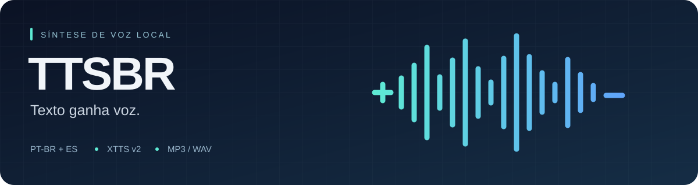

<div align="center">



# TTSBR

**Texto para voz em português brasileiro e espanhol.**

`XTTS v2` · `Python` · `Síntese local` · `MP3 / WAV`

[Começar](#instalacao) · [Exemplos](#primeiros-passos) · [Vozes](#idiomas) · [Glossários](#glossarios) · [Referência CLI](#opcoes)

</div>

Converta arquivos `.txt` em MP3 ou WAV com normalização de números, siglas e termos técnicos, controle de pausas e alternância de locutores. A síntese é executada localmente; o primeiro uso requer acesso à internet para baixar o modelo.

> **Do texto ao áudio**
> Arquivo `.txt` → idioma e pronúncia → síntese XTTS v2 → pausas e volume → MP3 / WAV

<details>
<summary><strong>Explorar a documentação</strong></summary>

- [Recursos](#recursos)
- [Instalação](#instalacao)
- [Primeiros passos](#primeiros-passos)
- [Idiomas e vozes](#idiomas)
- [Pausas e direção de voz](#pausas)
- [Glossários de pronúncia](#glossarios)
- [Opções de síntese](#opcoes)
- [Conferir o resultado](#conferencia)
- [Testes](#testes)
- [Limitações e solução de problemas](#problemas)
- [Estrutura do projeto](#estrutura)

</details>

---

<a id="recursos"></a>

## ✨ Recursos

| Texto e pronúncia | Voz e áudio | Conferência |
|:---|:---|:---|
| Detecção de PT-BR e espanhol | Múltiplos locutores no roteiro | Transcrição com Whisper |
| Números, siglas e unidades por extenso | Tags de pausa e volume | WER por distância de edição |
| Glossários por arquivo e idioma | Exportação MP3 e WAV | Medição de pausas e volume |
| Pronúncia de termos técnicos | CUDA, MPS ou CPU | Comparação de vozes |

---

<a id="instalacao"></a>

## 🚀 Instalação

Execute os comandos a partir da pasta do projeto. Use uma versão de Python compatível com as dependências do `requirements.txt`; a sintaxe do projeto requer Python 3.10 ou superior.

```bash
python3 -m venv .venv
source .venv/bin/activate
python -m pip install -r requirements.txt
```

No Windows, ative o ambiente com `.venv\Scripts\activate`.

A exportação MP3 usa o `ffmpeg` do sistema. Quando ele não está disponível, o pipeline tenta usar o executável fornecido por `imageio-ffmpeg`, incluído nas dependências.

Para usar as ferramentas auxiliares de validação, medição e comparação de vozes:

```bash
python -m pip install transformers librosa soundfile
```

> **Primeira execução**
> O XTTS v2 é baixado automaticamente. Os scripts de síntese definem `COQUI_TOS_AGREED=1`, sinalizando aceite dos termos do modelo. Consulte esses termos antes de usar o modelo.

<a id="primeiros-passos"></a>

## ▶️ Primeiros passos

Gere um áudio a partir de um dos textos de exemplo:

```bash
python tts.py teste1.txt --saida saida/teste1
```

Esse comando detecta o idioma por parágrafo e grava:

| Arquivo | Conteúdo |
|---|---|
| `saida/teste1.mp3` | Áudio final. |
| `saida/teste1.blocos.json` | Estimativa de duração, divisão em blocos, texto de cada bloco e `texto_falado` após normalização, remoção de tags e limpeza para síntese. |

A pasta de saída é criada automaticamente. Arquivos com o mesmo nome podem ser sobrescritos.

```bash
# MP3 e WAV na mesma execução
python tts.py teste1.txt --saida saida/teste1 --wav

# Apenas WAV
python tts.py teste1.txt --saida saida/teste1 --formatos wav

# Espanhol com voz específica
python tts.py teste_es.txt --idioma es --locutor "Xavier Hayasaka" --saida saida/teste_es

# Voz de referência para clonagem
python tts.py teste1.txt --voz referencia.wav --saida saida/voz_referencia

# Execução em CPU
python tts.py teste1.txt --dispositivo cpu --saida saida/teste_cpu
```

Use arquivos de texto em UTF-8. Separe os parágrafos com uma linha em branco. Para consultar a ajuda completa:

```bash
python tts.py --help
```

<a id="idiomas"></a>

## 🗣️ Idiomas e vozes

Em `--idioma auto`, cada parágrafo recebe uma detecção independente. As vozes padrão são:

| Idioma | Código | Locutor |
|---|---|---|
| Português brasileiro | `pt` | `Luis Moray` |
| Espanhol | `es` | `Alma María` |

A detecção usa regras e vocabulário. Para textos curtos ou ambíguos, informe `--idioma pt` ou `--idioma es`, ou use um rótulo de idioma no parágrafo.

`--locutor` define a voz dos trechos sem personagem explícito. `--voz` usa uma gravação de referência para todos os trechos e tem prioridade sobre as vozes embutidas; a orientação de uso é uma referência de 6 a 30 segundos.

### Diálogos com múltiplos locutores

Coloque o personagem no início de cada parágrafo:

```text
[Narrador]: No laboratório, a equipe compara os resultados.

[Luis|pt]: Conseguimos reduzir o erro para menos de 1%.

[Alma|es]: Excelente noticia. Ahora podemos iniciar las pruebas.
```

Os rótulos são removidos antes da síntese. Apelidos como `Narrador`, `Luis`, `Alma`, `Marcos`, `Gilberto`, `Ana`, `Sofia` e `Xavier` são convertidos para nomes de vozes embutidas. Também é possível informar o nome completo de um locutor.

- `[Alma|es]:` escolhe a personagem e força espanhol naquele parágrafo.
- `[es]:` força espanhol e usa a voz selecionada pelas opções do comando ou pelo idioma.
- `[Alma]:` escolhe a voz; o idioma continua sujeito à detecção ou à opção `--idioma`.

<a id="pausas"></a>

## 🎛️ Pausas e direção de voz

Insira as tags diretamente no texto:

```text
Ele analisou os resultados [pausa:1.5s] e tomou uma decisão.

[enfase] Este é o ponto fundamental: [respiro] precisamos conferir os dados.

Ele concluiu: [sussurro] tudo funcionou.
```

| Tag | Efeito | Sinônimos |
|---|---|---|
| `[pausa:1.5s]` ou `[pausa:800ms]` | Insere silêncio na posição da tag. Sem parâmetro, usa 1000 ms. | `[silencio:1.5s]` |
| `[respiro]` | Insere uma pausa de 400 ms; não gera som de respiração. | `[respiracao]` |
| `[enfase]` | Eleva o volume alvo do próximo trecho em 2,5 dB. | `[destaque]` |
| `[sussurro]` | Reduz o volume alvo do próximo trecho em 4 dB. | `[baixo]`, `[calmo]` |

As tags de volume afetam o próximo segmento dentro do trecho dividido para síntese. Elas alteram o volume, sem controlar timbre ou emoção. O ganho aplicado também depende do teto de pico e dos limites de normalização.

As pausas das tags podem se somar às pausas de pontuação e de parágrafo. Por exemplo, `Fim. [pausa:1s]` inclui a pausa correspondente ao ponto, além do silêncio solicitado. Para uma pausa explícita entre palavras, use `antes [pausa:1s] depois`.

<a id="glossarios"></a>

## 📖 Glossários de pronúncia

Use um glossário para ajustar nomes, termos técnicos e siglas. As entradas personalizadas têm prioridade sobre as pronúncias embutidas.

### Formato texto

Crie um arquivo como `meu_glossario.txt`:

```text
# Comentários começam com #
PostgreSQL = pós-gre-ésse-quê-éle
Kubernetes = cubernetes
GPU = placa gráfica
```

```bash
python tts.py teste1.txt --glossario meu_glossario.txt --saida saida/teste1
```

Veja também [glossario.txt.exemplo](glossario.txt.exemplo).

### Formato JSON e idiomas

```json
{
  "Kubernetes": "cubernetes",
  "GPU": "placa gráfica",
  "pt": {
    "AWS": "á-dáblio-ésse"
  },
  "es": {
    "AWS": "a-dobleve-ese"
  }
}
```

As entradas gerais são combinadas com a seção do idioma. Quando o mesmo termo aparece nas duas, a seção do idioma prevalece. A pronúncia substituída não passa novamente pela substituição de termos técnicos.

### Ordem de carregamento

Os arquivos são mesclados nesta ordem; para a mesma chave, o último valor vence:

1. `glossario.json` e depois `glossario.txt` no **diretório de trabalho atual**.
2. `<nome-do-texto>.glossario.json` e depois `<nome-do-texto>.glossario.txt`, ao lado do arquivo de entrada.
3. O arquivo indicado em `--glossario`.

As seções por idioma também são mescladas, preservando entradas que não foram sobrescritas. Por exemplo, para `roteiro.txt`, o glossário associado pode se chamar `roteiro.glossario.json`.

<a id="opcoes"></a>

## ⚙️ Opções de síntese

<details>
<summary><strong>Ver parâmetros, valores padrão e ajustes de pausa</strong></summary>

| Opção | Padrão | Uso |
|---|---|---|
| `--saida` | `audio` | Caminho base dos arquivos, sem extensão. |
| `--idioma` | `auto` | `auto`, `pt` ou `es`. |
| `--locutor` | Por idioma | Nome de uma voz embutida. |
| `--voz` | — | Caminho do áudio de referência para clonagem. |
| `--velocidade` | `1.1` | Velocidade de fala; `1.0` corresponde à velocidade original. |
| `--dispositivo` | `auto` | `auto`, `cpu`, `cuda` ou `mps`. |
| `--volume-alvo` | `-20.0` | Volume alvo em dBFS, sujeito aos limites de ganho e pico. |
| `--glossario` | — | Glossário adicional em TXT ou JSON. |
| `--formatos` | `mp3` | Formatos de exportação separados por vírgula, como `mp3,wav`. |
| `--wav` | Desativado | Acrescenta WAV aos formatos escolhidos. |
| `--sem-normalizar` | Desativado | Desativa a normalização fonética; as tags continuam sendo interpretadas. |
| `--sem-corte-silencio` | Desativado | Preserva o silêncio residual nas bordas dos trechos. |

### Ajustes de pausa

Todos os valores abaixo são informados em milissegundos:

| Opção | Padrão | Aplicação |
|---|---|---|
| `--pausa-frase` | `600` | Após `.`, `!` ou `?`. |
| `--pausa-reticencias` | `850` | Após `...` ou `…`. |
| `--pausa-ponto-virgula` | `420` | Após `;` ou `:`. |
| `--pausa-virgula` | `250` | Cortes intermediários, inclusive de frases longas. |
| `--pausa-paragrafo` | `1150` | Ao final do parágrafo; prevalece sobre a pausa da pontuação. |
| `--pausa-bloco` | `500` | Silêncio adicional entre blocos. |

Vírgulas dentro de um trecho não recebem necessariamente um silêncio inserido pelo script: o modelo interpreta a pontuação interna. O ajuste de vírgula é aplicado quando há divisão em segmentos.

</details>

<a id="conferencia"></a>

## 🎧 Conferir o resultado

### Validar a fala com Whisper

```bash
python validar_audio.py saida/teste1.mp3 teste1.txt
python validar_audio.py saida/teste_es.mp3 teste_es.txt --idioma es

# Aceitar até 15% de erro de palavras
python validar_audio.py saida/teste1.mp3 teste1.txt --limite-wer 0.15
```

A ferramenta transcreve o áudio com `openai/whisper-small` e compara a transcrição com o texto de referência. O primeiro uso pode baixar o modelo Whisper. É possível escolher outro modelo com `--modelo`.

O **WER** é calculado por distância mínima de edição:

```text
WER = (substituições + omissões + inserções) / palavras da referência
```

A comparação ignora acentos, pontuação, rótulos de personagem e tags, e expande números conforme o idioma escolhido. Exibe as divergências e alerta para inserções ou substituições contendo `ponto` ou `punto`.

- Código de saída `0`: WER dentro do limite, cujo padrão é `0.10` (10%).
- Código de saída `1`: WER acima do limite.

**Interpretação:** erros do próprio Whisper entram na medida. A validação não aplica o glossário fonético completo usado na síntese e trabalha com um único idioma por execução; termos personalizados e roteiros mistos podem gerar divergências mesmo quando a fala está correta. Ouça os trechos sinalizados antes de concluir que houve falha de síntese.

### Medir pausas e volume

```bash
python tts.py teste_expressividade.txt --saida saida/teste_expressividade --wav
python medir_audio.py saida/teste_expressividade.wav

# Ajustar a detecção de silêncio
python medir_audio.py saida/teste_expressividade.wav --min-pausa-ms 250 --limiar-db -45
```

A medição lista início, duração e volume RMS dos trechos de fala, além da duração das pausas detectadas. Os resultados dependem do limiar e da duração mínima escolhidos.

### Comparar vozes

```bash
python comparar_vozes.py --idioma pt  # amostras em saida/vozes/
python comparar_vozes.py --idioma es  # amostras em saida/vozes_es/
python comparar_vozes.py --listar
```

O script de comparação usa CPU. A opção `--listar` imprime as vozes disponíveis **e continua gerando as amostras** da seleção definida no script.

<a id="testes"></a>

## 🧪 Testes

Na pasta do projeto, com o ambiente virtual ativado:

```bash
python -m unittest discover -s tests -v
```

A suíte cobre detecção de idioma, números PT/ES, siglas, termos técnicos, abreviações, precedência e mescla de glossários, tags, pausas, corte de silêncio, divisão de frases e cálculo do WER.

Há também um teste de integração que verifica a correspondência entre o manifesto e os textos enviados à síntese, exportando um WAV temporário com sinal simulado. **Os testes não carregam o XTTS nem o Whisper e não avaliam a qualidade da voz real.**

<a id="problemas"></a>

## 🔧 Limitações e solução de problemas

| Situação | Orientação |
|---|---|
| `ModuleNotFoundError` | Ative o ambiente virtual e instale as dependências com o mesmo `python` usado para executar o script. |
| Falha na exportação MP3 | Confira a instalação de `ffmpeg` ou `imageio-ffmpeg`; use `--formatos wav` para verificar a exportação WAV. |
| Idioma detectado incorretamente | Use `--idioma pt`, `--idioma es` ou um rótulo como `[Alma\|es]:`. |
| Falha ou desempenho inadequado na GPU | Execute com `--dispositivo cpu` e compare o resultado. O desempenho depende do equipamento e do texto. |
| Ambiente virtual inacessível em sandbox | Verifique o acesso ao executável Python, às dependências e ao arquivo `pyvenv.cfg`. |
| WER alto com termos técnicos | Confira a transcrição e as pronúncias personalizadas; o WER não mede naturalidade nem timbre. |

Textos com mais de 450 palavras são agrupados em blocos com alvo de até 150 palavras, preservando frases completas. Uma frase isolada pode ultrapassar esse alvo; antes da síntese, os trechos normalizados são divididos para respeitar o limite de 200 caracteres adotado pelo script, preferindo cortes em vírgulas.

O pipeline remove pontos e outras marcas finais de cada segmento para reduzir a leitura literal da pontuação. As pausas são calculadas antes dessa limpeza. A escolha de voz e a qualidade do sotaque devem ser avaliadas por audição.

<a id="estrutura"></a>

## 📁 Estrutura do projeto

<details>
<summary><strong>Ver arquivos e responsabilidades</strong></summary>

```text
TTSBR/
├── tts.py                   # CLI, síntese e exportação
├── normalizador.py          # idioma, números e pronúncias PT/ES
├── validar_audio.py         # transcrição Whisper e WER
├── medir_audio.py           # pausas e volume RMS
├── comparar_vozes.py        # amostras de vozes embutidas
├── requirements.txt         # dependências da síntese
├── glossario.txt.exemplo    # modelo de glossário
├── teste*.txt               # textos de exemplo
├── tests/                   # testes de unidade e integração simulada
└── saida/                   # saídas dos exemplos; ignorada pelo Git
```

</details>

---

<div align="center">

[Voltar ao início](#ttsbr)

</div>
