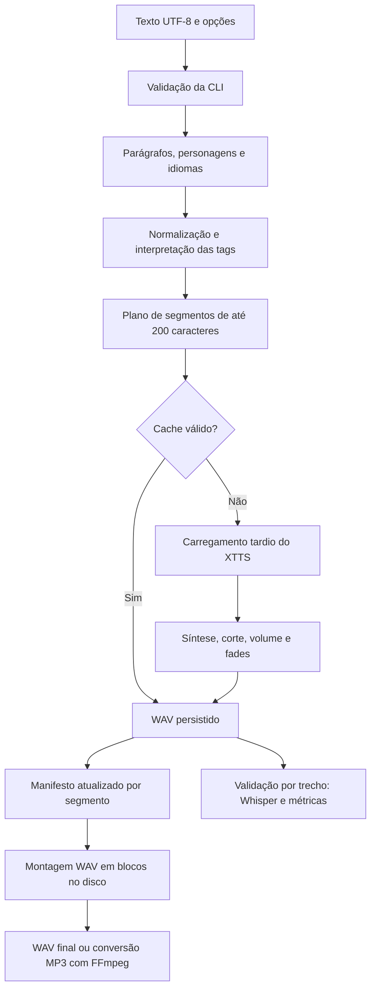

# Pipeline, persistência e limites

[README](../README.md) · [GUI](GUI.md) · [Referência](REFERENCIA.md) · [Avaliação](../avaliacao/GUIA.md)

## Etapas

O mesmo plano alimenta o manifesto e a geração. Tags são interpretadas antes dos cortes de comprimento, e a normalização preserva seu conteúdo. Só o primeiro segmento de texto após uma tag de volume recebe o modificador.

Textos com mais de 450 palavras são agrupados em blocos com alvo de 150 palavras. Frases não são partidas nessa etapa, então uma frase pode ultrapassar o alvo. O limite de 200 caracteres é aplicado depois da normalização, antes da síntese.

## Responsabilidades

| Arquivo | Responsabilidade |
|---|---|
| `gui.py`, `gui_core.py`, `gui_worker.py` | Janela Tkinter, snapshots, regeneração seletiva e processamento isolado, com eventos estruturados. |
| `caminhos.py` | Separa fontes, recursos distribuídos e dados graváveis na instalação por wheel. |
| `tts.py` | Ponto de entrada CLI, orquestração do plano, inferência XTTS v2 e progresso. |
| `segmentador.py` | Segmentação em blocos/frases, extração de tags de direção ([enfase], [pausa]) e preparação de texto. |
| `vozes.py` | Roteamento de vozes, mapeamento de personagens, resolução de tons/estilos e locutores padrão PT/ES. |
| `processamento_audio.py` | Corte de silêncio residual XTTS, compactação de pausas internas, normalização de ganho e detecção de anomalias. |
| `servidor_api.py` | *(Beta)* Servidor HTTP local compatível com o endpoint `/v1/audio/speech` da OpenAI, reutilizando o cache. |
| `normalizador.py` | Pipeline fonético, conversão de números/datas/moedas para extenso e regras de pronúncia. |
| `lexico.py` | Tabelas estáticas, vocabulário PT/ES, siglas, termos técnicos de IA e abreviações. |
| `audio_persistente.py` | Chaves, integridade, higienização de referência, gravação dos segmentos, legendas `.srt`/`.vtt`, montagem e exportação (LUFS, resampling e BGM ducking). |
| `validar_audio.py` | ASR, alinhamento, WER, agregação e relatórios. |
| `qualidade_audio.py` | Duração, energia RMS, pico e amostras próximas da saturação. |
| `medir_audio.py` | Segmentação de fala e pausas por limiar. |

## Cache por conteúdo e parâmetros

Cada WAV mono PCM de 16 bits a 24 kHz é acompanhado por um JSON. O nome é o SHA-256 dos parâmetros serializados de forma ordenada. Os metadados guardam os parâmetros, a quantidade de frames e o SHA-256 do WAV.

A reutilização exige formato compatível, frames positivos, quantidade de frames correspondente, parâmetros iguais e hash do arquivo correto. Ausência ou corrupção causa nova síntese daquele segmento. O cache não depende da numeração de sua ocorrência: frases idênticas com parâmetros iguais podem compartilhar o mesmo arquivo.

A chave considera texto normalizado, idioma, locutor ou hash do conteúdo da referência, velocidade, volume, corte, dispositivo solicitado, modelo, versão do pipeline e versões de Coqui TTS, Torch, NumPy e Pydub. Pausas e formatos de exportação ficam fora da chave, permitindo remontagem sem inferência.

Os pesos do XTTS e hashes dos arquivos Python não estão na chave. Após substituir pesos ou alterar manualmente o processamento, use `--refazer` ou atualize a versão do pipeline no código. A retomada não é uma promessa de reprodução bit a bit entre máquinas ou ambientes.

## Escritas e recuperação

- Segmentos são exportados para temporários e movidos ao nome definitivo. Seus metadados são gravados em seguida. Uma interrupção entre os dois deixa uma entrada que será verificada ou refeita.
- O manifesto é substituído por um JSON temporário, com flush e sincronização do arquivo, após cada segmento. Ele registra progresso confirmado, não uma fila completa de trabalhos pendentes.
- Uma nova execução reconstrói o plano e verifica o cache; não depende do estado anterior do manifesto.
- A montagem usa uma pasta temporária no diretório de saída. Cada formato concluído substitui sua saída anterior individualmente. Não há transação conjunta entre MP3 e WAV: se o segundo formato falhar, o primeiro pode já ter sido atualizado.
- Se a inferência ou a exportação falhar, os segmentos concluídos permanecem disponíveis. `--refazer` força nova inferência; a limpeza do cache é manual.

Não há bloqueio para duas execuções com o mesmo nome base. Para processamento simultâneo, use nomes de saída diferentes. Desligamento abrupto e falhas do dispositivo de armazenamento podem deixar temporários; o mecanismo não equivale a backup.

## Memória e armazenamento

O áudio completo não é concatenado em um `AudioSegment`. A montagem lê e escreve buffers de até 64 KiB; silêncios são escritos em blocos. O plano e o manifesto continuam em memória, e a inferência mantém o modelo e um segmento na memória.

O WAV intermediário é PCM mono de 16 bits a 24 kHz: aproximadamente 48.000 bytes por segundo, além do cabeçalho. Reserve espaço para o cache, o intermediário e os formatos finais. O limite RIFF aproximado de 4 GB é verificado antes da montagem; não há saída RF64.

A validação processa um segmento por vez. O Whisper é reutilizado entre trechos, enquanto o alinhamento de WER armazena caminhos de edição proporcionais ao produto dos comprimentos dos textos. A validação de um áudio final longo pode custar mais memória que a validação por segmentos.

## Cobertura e limites de qualidade

A suíte verifica os contratos de preparação, persistência, retomada, integridade, exportação, linha do tempo, normalização e validação. A inferência dos testes é simulada, mas a exportação MP3 usa FFmpeg real.

A execução real de referência está em [resultado_inicial.json](../avaliacao/resultado_inicial.json). WER e métricas acústicas não medem naturalidade, sotaque ou preferência de voz. O protocolo de audição está no [guia de avaliação](../avaliacao/GUIA.md).

## Interface e callbacks

A GUI não importa o pipeline no processo da janela. Um worker usa o Python configurado para chamar `tts.main(argv, on_event, should_stop)`. Os callbacks são opcionais; os comandos anteriores continuam disponíveis. A análise usa `--analisar`, encerrando após a preparação do plano.

Eventos comunicam plano, etapa, segmentos concluídos, resultado ou interrupção. A thread leitora do subprocesso envia eventos a uma fila limitada; o event loop do Tkinter é o único responsável por alterar widgets. Os logs visíveis também têm limite de tamanho.

A interrupção é cooperativa, verificada antes de processar um segmento e antes da montagem. Após solicitação, o trecho em andamento termina, o cache é preservado e o manifesto recebe `interrompido`. Downloads, chamadas de inferência e exportação não são interrompidos no meio. O processo de validação emite progresso por segmento, reutilizando o mesmo transcritor.

## Construção e instalação

A lista de módulos e recursos é explícita no `pyproject.toml`. `scripts/construir.py` trabalha em uma cópia temporária pública para impedir que diretórios privados e metadados AppleDouble do volume externo contaminem a distribuição. A GUI e a API usam `caminhos.pasta_dados()` para dados graváveis; recursos instalados são localizados em `share/ttsbr` do ambiente Python. Os resultados de instalação e as validações restantes estão em [ESTABILIZACAO.md](ESTABILIZACAO.md).
