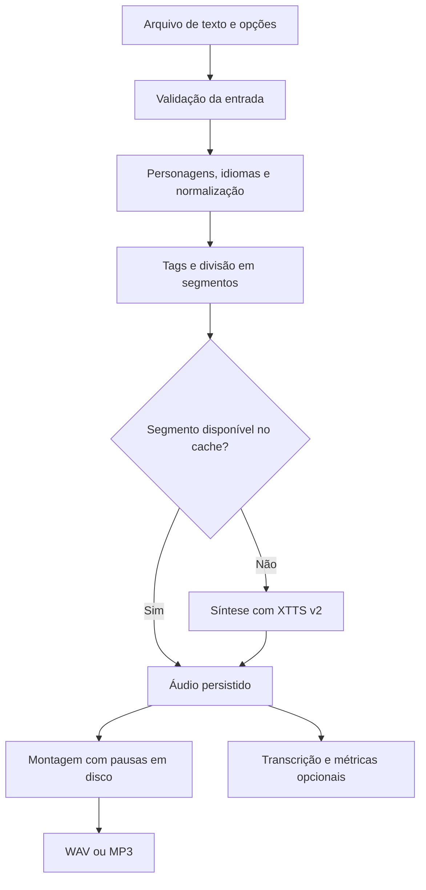

# Sobre o TTSBR

**O que o projeto faz, como funciona e quais são seus limites.**

[README](../README.md) · [Referência de comandos](REFERENCIA.md) · [Arquitetura](ARQUITETURA.md) · [Avaliação de qualidade](../avaliacao/GUIA.md)

O TTSBR é uma ferramenta de linha de comando que transforma arquivos de texto em narração, com suporte a português brasileiro e espanhol. Ele utiliza o XTTS v2 para gerar a voz e acrescenta preparação do texto, controle de pausas, persistência dos segmentos e ferramentas de avaliação.

Seu uso principal é a produção de narrações a partir de roteiros preparados. O projeto não escreve o conteúdo e não dispensa a revisão do áudio por audição.

## Como funciona



O processamento começa com um `.txt` em UTF-8. O programa identifica parágrafos e personagens, prepara a pronúncia, interpreta as tags e divide o conteúdo em trechos. Cada trecho é sintetizado ou recuperado do cache. Os segmentos são então montados com as pausas e exportados.

## Idiomas, vozes e diálogos

O projeto oferece detecção de português ou espanhol por parágrafo e permite informar o idioma explicitamente.

| Idioma | Código | Voz padrão |
|---|---|---|
| Português brasileiro | `pt` | Luis Moray |
| Espanhol | `es` | Alma María |

Também é possível escolher outra voz embutida ou usar uma gravação de referência para clonagem. A duração recomendada da referência é de 6 a 30 segundos; a CLI verifica a existência do arquivo, mas não avalia previamente a qualidade da gravação nem sua duração.

Roteiros podem alternar personagens:

```text
[Luis|pt]: Vamos conferir os resultados.

[Alma|es]: Ahora podemos iniciar las pruebas.
```

Os rótulos são removidos antes da síntese. A prioridade de escolha é: referência em `--voz`, personagem explícito, `--locutor` e voz padrão do idioma. Uma referência em `--voz` vale para todos os trechos.

**Limites:** a detecção usa regras e vocabulário. Frases curtas, palavras compartilhadas e parágrafos com idiomas misturados podem ser classificados incorretamente. A alternância automática acontece por parágrafo, não palavra por palavra. O pipeline público é preparado para PT/ES; ele não expõe todos os idiomas que o modelo subjacente possa oferecer.

## Preparação da pronúncia

O normalizador converte elementos escritos para formas mais adequadas à fala:

| Entrada | Exemplo de leitura em português |
|---|---|
| `95%` | noventa e cinco por cento |
| `16GB` | dezesseis gigabytes |
| `29/10/2026` | vinte e nove de outubro de dois mil e vinte e seis |
| `10:30` | dez horas e trinta minutos |
| `R$ 12,50` | doze reais brasileiros e cinquenta centavos |
| `-5` | menos cinco |
| `GPU`, `API`, `IA` | Pronúncias cadastradas para as siglas. |

Há regras equivalentes para espanhol e um conjunto de aproximações fonéticas para termos técnicos em inglês. Glossários personalizados permitem ajustar nomes próprios, marcas, termos e siglas, com entradas gerais e por idioma.

**Limites:** a normalização não compreende o significado completo da frase. As aproximações fonéticas não garantem pronúncia perfeita, e os formatos reconhecidos têm convenções específicas:

- Datas usam dia/mês/ano, com ano de quatro dígitos.
- Horários seguem o formato de 24 horas.
- Valores monetários usam vírgula decimal e ponto para milhares.
- `$` é interpretado como dólar americano.
- Valores com ponto decimal ou símbolo monetário após o número não têm tratamento monetário específico.
- Uma expressão como `10:30` é interpretada como horário, mesmo que represente um capítulo ou uma proporção.
- URLs, fórmulas, código, tabelas e notação científica não têm uma leitura especializada completa.
- Aspas e pontuação ambígua ainda podem dificultar a divisão de frases.

Para casos específicos, escreva a leitura desejada, ajuste o glossário ou use `--sem-normalizar`. Essa opção desativa a normalização fonética, mas mantém a interpretação de tags e personagens.

## Pausas e direção de voz

As instruções podem ser escritas no próprio roteiro:

```text
Confira os dados [pausa:800ms] antes de continuar.

[enfase] Esta informação é importante.

[sussurro] Podemos conversar depois.
```

| Tag | Efeito implementado |
|---|---|
| `[pausa:800ms]` | Insere silêncio na posição indicada. |
| `[respiro]` | Insere 400 ms de silêncio. |
| `[enfase]` | Aumenta o volume alvo do próximo segmento em 2,5 dB. |
| `[sussurro]` | Reduz o volume alvo do próximo segmento em 4 dB. |

As tags são interpretadas antes dos cortes de comprimento. Tags desconhecidas, incompletas ou com parâmetros inválidos interrompem a execução com erro.

**Limites:** essas instruções controlam silêncio e volume. Não controlam emoção ou timbre: `[sussurro]` não garante um sussurro real, e `[respiro]` não produz som de respiração. O ganho aplicado depende dos limites de normalização e pico. As pausas explícitas podem se somar às pausas de pontuação e parágrafo. Colchetes usados como conteúdo comum também podem ser interpretados como tentativa de tag.

## Tratamento e exportação de áudio

Após a síntese, o pipeline pode remover excesso de silêncio nas bordas, ajustar o volume por segmento e aplicar fades curtos. O corte de silêncio pode ser desativado.

| Característica | Comportamento |
|---|---|
| Áudio intermediário | WAV PCM mono, 16 bits, 24 kHz. |
| Formatos finais | WAV e MP3. |
| MP3 | Exportação a 192 kbps com FFmpeg. |
| Volume | Ajuste em dBFS, sujeito aos limites de ganho e pico. |
| Montagem | Cópia de segmentos e inserção de pausas em disco. |

**Limites:** o projeto não realiza masterização completa. Não oferece tratamento especializado de ruído, equalização, compressão musical, mixagem de trilhas ou normalização perceptiva em LUFS. O ajuste em dBFS não garante a mesma sensação de volume entre vozes. O corte de silêncio usa limiares e margens; pode preservar silêncio demais ou afetar partes muito suaves.

## Cache e retomada

Cada segmento concluído é salvo em `<saida>.segmentos/`, junto com seus parâmetros e metadados de integridade. Se a execução for interrompida, repetir o comando permite verificar o cache e gerar apenas os segmentos ausentes ou inválidos.

Mudanças em texto, idioma, voz, velocidade ou processamento podem exigir nova síntese. Alterar apenas pausas ou formatos permite reutilizar a fala e refazer a montagem. Quando o cache está completo, o XTTS não precisa ser carregado.

A opção `--refazer` força uma nova geração. O manifesto `.blocos.json` registra progresso, segmentos, tempos e informações do ambiente.

**Limites:** o cache ocupa espaço e não é limpo automaticamente. Os pesos do modelo e os hashes das fontes Python não fazem parte automaticamente da chave de reutilização. Após alterações manuais nesses elementos, pode ser necessário usar `--refazer`. Mover o projeto exige atualizar os caminhos absolutos do manifesto ou executar novamente a síntese no novo local. Não há bloqueio para execuções simultâneas com o mesmo nome base; use saídas diferentes. Cache e temporários não substituem backup.

## Textos longos, memória e desempenho

Acima de 450 palavras, o texto é agrupado em blocos com alvo de 150 palavras. Como essa etapa preserva frases completas, um bloco pode ultrapassar esse alvo. Antes da síntese, os trechos são divididos para respeitar o limite de 200 caracteres adotado pelo script.

A montagem final usa buffers pequenos em disco, evitando acumular a narração inteira em um único objeto de áudio. O modelo e o segmento em geração ainda consomem memória, e o plano de processamento permanece em memória.

O projeto tenta selecionar CUDA, MPS ou CPU conforme a disponibilidade. O desempenho depende do equipamento, do ambiente, da voz e do texto; não há garantia de aceleração, estabilidade em qualquer GPU ou geração em tempo real.

**Limites:** dividir a fala em segmentos pode reduzir a continuidade da entonação. É necessário espaço para cache, WAV intermediário e saídas finais. O WAV RIFF tem limite aproximado de 4 GB, inclusive quando a saída escolhida é somente MP3, pois a montagem intermediária usa WAV. Cada formato final é substituído individualmente: se uma exportação posterior falhar, uma saída anterior já pode ter sido atualizada.

## Avaliação e conferência

As ferramentas de avaliação são opcionais e têm objetivos diferentes:

| Ferramenta ou modo | O que verifica |
|---|---|
| Áudio final + texto original | Transcrição do arquivo informado, com um idioma por execução. |
| Validação por manifesto | Transcrição de cada WAV do cache no respectivo idioma. |
| `--somente-metricas` | Duração, RMS, pico e amostras próximas da saturação, sem Whisper. |
| Medição de pausas | Trechos de fala e silêncio detectados por limiar. |
| Comparação de vozes | Amostras de uma seleção de vozes embutidas. |

O relatório por manifesto inclui transcrição, divergências, WER por segmento e idioma, WER global e posição temporal de cada fala.

O **WER** é a taxa de palavras substituídas, omitidas ou inseridas em relação à referência. A aprovação por manifesto exige que cada segmento respeite o limite escolhido; o padrão é 10%. Um WER global baixo pode coexistir com reprovação de um trecho.

**Limites:** o WER não mede naturalidade, emoção, compreensão, sotaque ou semelhança com a referência de voz. Erros do Whisper e diferenças de escrita entram na conta. Grafias fonéticas podem divergir da ortografia escolhida pelo transcritor. A validação por manifesto não verifica a codificação MP3 nem a montagem final. O modo de métricas não concede aprovação da fala, e as medidas acústicas não substituem audição.

A [medição inicial](../avaliacao/resultado_inicial.json), realizada com XTTS e Whisper reais, contém oito segmentos e WER global de aproximadamente 1,2%, sem avisos acústicos. Esse resultado vale para aquele corpus e ambiente. Naturalidade e sotaque não foram avaliados por audição. O [guia de avaliação](../avaliacao/GUIA.md) inclui um protocolo para essa revisão.

## O que o projeto não oferece atualmente

- Interface gráfica, editor de roteiro ou painel de revisão.
- API HTTP, serviço multiusuário ou fila de processamento.
- Streaming de voz em tempo real.
- Importação direta de PDF, Word, páginas da web ou imagens.
- Escrita, pesquisa, revisão editorial ou tradução automática do roteiro.
- Dublagem sincronizada com vídeo ou movimento labial.
- Música de fundo, efeitos sonoros ou mixagem de várias trilhas.
- Legendas com alinhamento de cada palavra.
- Controle confiável de emoção, interpretação ou sotaque.
- Garantia de reprodução idêntica entre máquinas e execuções.

## Instalação e execução local

A síntese é executada localmente. A instalação das dependências e o primeiro download dos modelos requerem acesso à rede; o uso posterior depende da disponibilidade dos modelos e do ambiente local. A validação com Whisper pode exigir um download separado.

As dependências não estão fixadas por versão, portanto instalações futuras podem apresentar diferenças de compatibilidade ou comportamento. Os scripts de síntese definem `COQUI_TOS_AGREED=1`; os termos do modelo devem ser consultados antes do uso.

O TTSBR é adequado para gerar narrações de roteiros preparados, recuperar trabalho após interrupções e apoiar a revisão com transcrição e métricas. Para publicar um áudio, a conferência do conteúdo e a audição do resultado continuam sendo etapas necessárias.
